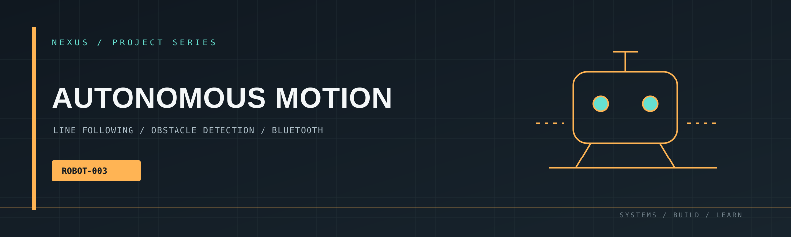

# Line-Following and Obstacle-Detection Robot

<div align="center">



</div>

An educational robotics project focused on a mobile robot designed to follow a line, detect obstacles and support Bluetooth-based control.

## Project overview

The project explores the combination of basic robotics concepts:

- Line-following behavior.
- Obstacle detection.
- Mobile robot control.
- Bluetooth-based interaction.

The implementation details and exact hardware configuration should be read from the source code and the physical prototype.

## Main learning areas

- Embedded programming.
- Sensor-based behavior.
- Control logic for a mobile robot.
- Integration of electronic and software components.
- Testing and iteration on a physical system.

## Technologies and components

The exact microcontroller, sensors, motor driver, Bluetooth module and wiring must be documented from the components actually used in this project. No unverified component list is assumed here.

## Repository

The default branch is `Robot_Voiture`.

Clone the project:

```bash
git clone https://github.com/HoussamEssaki/ROBOT-VOITURE-SUIVEUR-DE-LIGNE-ET-DETECTEUR-D-OBSTACLE-AVEC-CONTROLE-BLUETOOTH.git
cd ROBOT-VOITURE-SUIVEUR-DE-LIGNE-ET-DETECTEUR-D-OBSTACLE-AVEC-CONTROLE-BLUETOOTH
```

Open the project in the development environment appropriate for the microcontroller and code files present in the repository.

## Demonstration

Add original photos or a short video of the assembled robot here. A useful project presentation should show:

1. The physical prototype.
2. The line-following test.
3. The obstacle-detection test.
4. The Bluetooth-control demonstration.

## Documentation to complete

- Verified bill of materials.
- Wiring diagram.
- Pin mapping.
- Firmware setup and upload instructions.
- Control logic and sensor behavior.
- Known limitations and test conditions.

## Future improvements

- Add a clear hardware architecture diagram.
- Document calibration and test procedures.
- Add a concise demonstration video.
- Separate hardware documentation from firmware documentation.

---

**Educational project — Robotics and Embedded Systems.**
